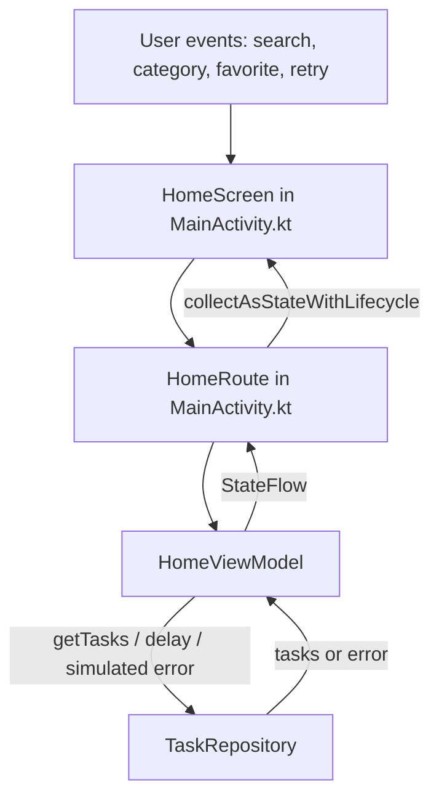

# StudyFlow

StudyFlow is an Android prototype that helps university students keep track of
assignments and deadlines. The current SIS 4 version demonstrates the MVVM flow
with sample tasks held by an in-memory repository; Room persistence is planned
but is not implemented in this version.

## Project idea

Students track assignments across systems such as Teams, group chats, and paper
notes. StudyFlow is intended to bring those deadlines into one place. This
prototype displays sample tasks and demonstrates the architecture needed for
future task editing and persistent storage.

## Functionality list

1. View sample study tasks and open their detail screens.
2. Search task titles and subjects.
3. Filter tasks by subject.
4. Mark and unmark tasks as favourites.
5. See loading, empty, and error states; trigger a sample error and retry.
6. Keep search, category, and favourite state through Activity recreation.

## Current folder structure

```
StudyFlow/
├── README.md
├── AI_USAGE.md
├── design/
│   └── mvvm-architecture.md
├── build.gradle.kts               # top-level Gradle build file
├── settings.gradle.kts            # project + module declaration, repositories
├── gradle.properties
├── gradlew / gradlew.bat          # Gradle wrapper scripts
├── gradle/
│   ├── libs.versions.toml         # dependency version catalog
│   └── wrapper/
│       ├── gradle-wrapper.jar
│       └── gradle-wrapper.properties
└── app/
    ├── build.gradle.kts
    └── src/main/java/com/example/studyflow/
        ├── MainActivity.kt                 # routes and stateless screens
        ├── data/TaskRepository.kt           # sample data, delay, simulated error
        ├── ui/HomeUiState.kt                # immutable screen state
        ├── ui/viewmodel/HomeViewModel.kt    # state and user actions
        └── ui/theme/                        # Compose theme
```

Not committed to Git (ignored via `.gitignore`): `/build`, `app/build`, `.gradle/`,
`local.properties`, `.idea/` and other local IDE/config files.

## Build & run instructions

Requirements: Android Studio (Ladybug or newer), JDK 17 (bundled with Android
Studio), Android SDK 34+.

1. Clone the repository:
   ```
   git clone <repo-url>
   cd StudyFlow
   ```
2. Open the folder in Android Studio (`File → Open`) and let Gradle sync finish.
3. Choose a device: a connected Android phone with USB debugging enabled, or an
   emulator created in `Device Manager` (Pixel, API 34).
4. Press `Run ▶` (or `Shift + F10`) to build and install the app.

From the command line instead:

```
./gradlew assembleDebug     # build a debug APK
./gradlew installDebug      # build and install on the connected device
```

## Tech stack

- Kotlin
- Jetpack Compose (Empty Activity template)
- Room (local database) — planned for the next stage
- Gradle Kotlin DSL

## SIS 4 — MVVM architecture



`HomeUiState` (in `ui/HomeUiState.kt`) carries the repository tasks, the
ViewModel-filtered visible tasks, search text, selected category, favourite IDs,
loading state, and an optional error. `HomeScreen` only renders that state and
emits callbacks; searching and category filtering happen in `HomeViewModel`.
`TaskRepository` owns the sample data and adds a server-like delay. Its
`shouldFail` parameter simulates a failed load.

### Trace one click: selecting a category

`CategoryChip` in `MainActivity.kt` calls `HomeScreen`'s
`onCategorySelected(category)` callback. `HomeRoute` connects that callback to
`HomeViewModel.onCategorySelected`. The ViewModel copies `HomeUiState` with the
new `selectedCategory` and recomputes `visibleTasks`; `StateFlow` emits the new
state, `HomeRoute` collects it with `collectAsStateWithLifecycle()`, and
`HomeScreen` renders the matching task cards.

### Rotation proof

I typed `Kotlin` in search and marked the matching task as a favourite, then
rotated the emulator. The old Activity paused, stopped, and was destroyed; a
new Activity started and resumed for the new orientation. `HomeViewModel.init`
appeared only once, and the search text and favourite were still visible after
rotation, showing that this UI state stayed in the ViewModel.

```text
10-27 18:34:32.326 D MainActivity: onCreate
10-27 18:34:32.379 D MainActivity: onStart
10-27 18:34:32.400 D MainActivity: onResume
10-27 18:34:32.634 D HomeViewModel: init
10-27 18:35:01.870 D MainActivity: onPause
10-27 18:35:01.916 D MainActivity: onStop
10-27 18:35:01.926 D MainActivity: onDestroy
10-27 18:35:01.940 D MainActivity: onCreate
10-27 18:35:01.945 D MainActivity: onStart
10-27 18:35:01.945 D MainActivity: onResume
```

## Author

Inara — Information Systems student, Android Development course, SIS1.
