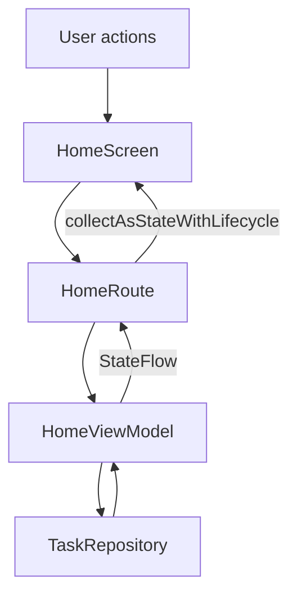

# StudyFlow — MVVM Architecture

## 1. Screens (View)

- HomeScreen — displays task cards, categories, and the list of tasks.
- DetailScreen — displays details of the selected task.
- ProfileScreen — displays the user's profile.

## 2. ViewModel

- HomeViewModel — manages the home screen state and user actions.

## 3. UiState

HomeUiState contains:

- tasks — list of tasks to display
- visibleTasks — repository tasks after ViewModel filtering
- searchQuery — current search text
- selectedCategory — currently selected category
- favoriteTaskIds — IDs of favorite tasks
- isLoading — whether data is loading
- error — error message, if loading fails

## 4. User Events

- onSearchChange(query)
- onCategorySelected(category)
- onFavouriteClick(taskId)
- onRetry()

## 5. Repository

TaskRepository owns the task data. It loads tasks asynchronously, simulates network delay, and can simulate a loading error.

## 6. Trace One Click

When a user taps a `CategoryChip` in `MainActivity.kt`, `HomeScreen` emits
`onCategorySelected(category)`. `HomeRoute` delegates it to
`HomeViewModel.onCategorySelected`, which copies `HomeUiState` and recomputes
`visibleTasks`. The `StateFlow` update is collected in `HomeRoute` with
`collectAsStateWithLifecycle()`, and the stateless `HomeScreen` redraws the
matching task cards.
